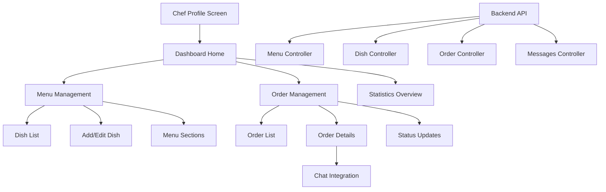

# Design Document

## Overview

The Chef Dashboard Screens feature provides a comprehensive mobile interface for chefs to manage their business operations within the existing app ecosystem. The design leverages the established backend API endpoints and integrates seamlessly with the current app architecture while maintaining consistency with the existing design system.

The dashboard consists of four main sections: Dashboard Home, Menu Management, Order Management, and Chat Integration. Each section is designed to provide intuitive navigation and efficient workflow management for chef users.

## Architecture

### High-Level Architecture



### Navigation Flow

The dashboard follows a hierarchical navigation pattern:
1. **Entry Point**: Chef Profile Screen → Dashboard Button
2. **Main Hub**: Dashboard Home with quick access cards
3. **Feature Sections**: Menu Management, Order Management
4. **Detail Views**: Individual dish/order management
5. **Integrated Features**: Chat accessible from order details

## Components and Interfaces

### 1. Dashboard Home Screen

**Purpose**: Central hub providing overview and navigation to all chef features

**Components**:
- Header with chef profile info and notifications
- Statistics cards (total orders, active dishes, revenue)
- Quick action buttons for common tasks
- Recent activity feed
- Navigation cards to main sections

**API Integration**:
- `GET /api/orders/chef/:chefId` - Fetch order statistics
- `GET /api/menus/chef/:chefId` - Fetch menu information
- `GET /api/dishes/menu/:menuId` - Fetch dish count

### 2. Menu Management Section

**Purpose**: Complete CRUD operations for menu and dish management

**Components**:

#### Menu Overview
- Menu header with name and description
- Section-based dish organization
- Add new dish floating action button
- Search and filter functionality

#### Dish Management
- Dish cards with image, name, price, and quick actions
- Add/Edit dish modal with form fields:
  - Name (required)
  - Description
  - Price (required)
  - Category (required)
  - Section selection
  - Image upload
  - Visibility toggle

**API Integration**:
- `GET /api/menus/chef/:chefId` - Fetch chef's menu
- `GET /api/dishes/menu/:menuId` - Fetch menu dishes
- `POST /api/dishes` - Create new dish
- `PUT /api/dishes/:id` - Update existing dish
- `DELETE /api/dishes/:id` - Delete dish
- `GET /api/sections/chef/:chefId` - Fetch menu sections

### 3. Order Management Section

**Purpose**: View, track, and manage customer orders with status updates

**Components**:

#### Order List View
- Tabbed interface for order status filtering (All, Pending, Confirmed, Preparing, Ready, Delivered)
- Order cards showing:
  - Order ID and timestamp
  - Customer name and avatar
  - Order items summary
  - Total price
  - Current status
  - Unread message indicator

#### Order Details View
- Customer information and delivery address
- Detailed item list with quantities and prices
- Order totals breakdown (subtotal, fees, tax)
- Status update controls
- Special instructions display
- Chat access button

**API Integration**:
- `GET /api/orders/chef/:chefId` - Fetch chef's orders
- `GET /api/orders/:id` - Fetch specific order details
- `PUT /api/orders/:id/status` - Update order status

### 4. Chat Integration

**Purpose**: Enable real-time communication between chefs and customers

**Components**:
- Chat interface accessible from order details
- Message history display
- Real-time message sending and receiving
- Order context integration
- Notification badges for unread messages

**API Integration**:
- `GET /api/messages/:userId` - Fetch chat messages
- `POST /api/messages` - Send new message
- `GET /api/messages/chats` - Get chat list
- WebSocket integration for real-time updates

## Data Models

### Frontend Data Structures

```typescript
interface ChefDashboardStats {
  totalOrders: number;
  activeOrders: number;
  totalDishes: number;
  todayRevenue: number;
  weeklyRevenue: number;
}

interface MenuData {
  _id: string;
  name: string;
  description: string;
  chef: string;
  dishes: DishData[];
  sections: SectionData[];
}

interface DishData {
  _id: string;
  name: string;
  description: string;
  price: number;
  category: string;
  section: string;
  image: string;
  visible: boolean;
  average_rating: number;
}

interface OrderData {
  _id: string;
  user: UserData;
  chef: string;
  items: OrderItem[];
  totalPrice: number;
  subtotal: number;
  deliveryFee: number;
  serviceFee: number;
  status: OrderStatus;
  deliveryAddress: Address;
  specialInstructions: string;
  created_at: Date;
}

type OrderStatus = 'pending' | 'confirmed' | 'preparing' | 'ready' | 'delivered' | 'cancelled';

interface ChatMessage {
  _id: string;
  sender: string;
  receiver: string;
  message: string;
  timestamp: Date;
  read: boolean;
}
```

## Error Handling

### API Error Management
- Network connectivity errors with retry mechanisms
- Authentication errors with redirect to login
- Validation errors with user-friendly messages
- Server errors with fallback UI states

### User Experience Error Handling
- Loading states for all async operations
- Empty states for lists with no data
- Error boundaries for component crashes
- Offline mode indicators and cached data access

### Form Validation
- Real-time validation for dish creation/editing
- Image upload error handling with size/format restrictions
- Required field validation with clear error messages
- Price validation for numeric inputs

## Testing Strategy

### Unit Testing
- Component rendering and prop handling
- API service functions and error handling
- Data transformation utilities
- Form validation logic

### Integration Testing
- API endpoint integration
- Navigation flow between screens
- Real-time chat functionality
- Order status update workflows

### End-to-End Testing
- Complete chef workflow from login to order management
- Menu creation and dish management flows
- Order processing and status updates
- Chat integration with customer communication

### Test Data Generation
- Automated creation of test orders with various statuses
- Mock customer data for realistic testing scenarios
- Test chef accounts with pre-populated menus
- Chat conversation test data

## Design System Integration

### Visual Design Principles
- Use exact same color palette as existing Tikto app screens for perfect consistency
- Typography hierarchy following Tikto's established guidelines
- Spacing and layout grid system compliance matching Tikto's design system
- Icon library integration using Tikto's existing iconography

### Component Library Usage
- Reuse existing UI components (buttons, cards, inputs)
- Extend component library for dashboard-specific needs
- Maintain accessibility standards across all components
- Responsive design for various screen sizes

### Animation and Transitions
- Smooth page transitions between dashboard sections
- Loading animations for data fetching
- Success/error feedback animations
- Gesture-based interactions for mobile optimization

## Performance Considerations

### Data Management
- Efficient API call patterns with caching strategies
- Pagination for large order lists
- Image optimization and lazy loading
- Real-time updates without excessive re-renders

### Mobile Optimization
- Touch-friendly interface design
- Optimized for various screen sizes
- Efficient memory usage for smooth performance
- Battery-conscious background operations

### Offline Capabilities
- Cached data access for basic functionality
- Queue pending actions for when connectivity returns
- Offline indicators and graceful degradation
- Local storage for draft dish edits